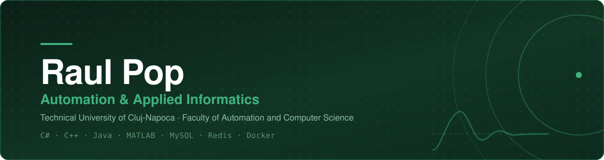
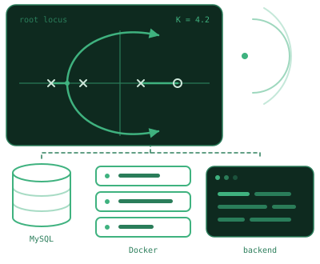

  

## Hi, I'm Raul 👋

**Automation & Applied Informatics student @ TUCN**

I like the part of engineering where control theory meets actual software — writing the math myself, then wrapping it in something you can click. Most of what I build ends up being desktop tools, backends and databases that have to hold up under real use, not just compile.

I'm in my third year of **Automation and Applied Informatics** at the *Faculty of Automation and Computer Science*, **Technical University of Cluj-Napoca** — 9.78/10 over the first two years, on the Academic Performance Scholarship. In parallel I'm going through the **Teacher Training Program** at the Psychopedagogical Specialty Department (DSPP).

My projects tend to sit on both sides of that line: a C++ tool that does root locus, Bode and Runge–Kutta simulation with a math library written from scratch; a Java inventory manager with Redis-backed sessions and rate limiting; a 17-table MySQL schema with business rules enforced at schema level; and a live .NET workout app deployed on Oracle Cloud behind Caddy and Cloudflare.

Lately I've been working on **system identification in MATLAB/Simulink** — fitting a second-order model to an active suspension from its damped response, then validating state-space and transfer-function forms against measured data.

Outside work: sci-fi and fantasy, guitar, the gym and cooking.

 

---

## 🛠️ Tech Stack

**Languages**

**Frameworks & Libraries**

**Databases**

**Tools & Platforms**

---

## 🚀 Projects

### [NoMoreQuiting](https://github.com/raulpop-codes/NoMoreQuiting) · [nomorequiting.com](https://nomorequiting.com)

Live workout-tracking web app, built in a two-person team — Gym and Fitness sections, custom categories, live session logging (sets/reps/weight) and friend leaderboards. I work on the ASP.NET Core backend and the MySQL schema behind a 40+ exercise catalog, plus deployment: Docker Compose on Oracle Cloud, served through Caddy with automatic HTTPS and Cloudflare.

`C#` · `ASP.NET Core` · `React` · `MySQL` · `Redis` · `Docker`

### [Control Systems Visualization Tool](https://github.com/raulpop-codes/Control-Systems-Visualization-Tool) 

Desktop tool for analyzing linear control systems: state-space ↔ transfer-function conversion (Faddeev–LeVerrier, controllable canonical form), an interactive root locus with branch tracking and a live gain slider, step and impulse response via fourth-order Runge–Kutta, plus Bode, Nichols and Nyquist views with gain and phase margins. The complex-number, matrix and polynomial layer (Durand–Kerner root-finding) is written from scratch, with no external math dependencies.

`C++17` · `SFML 3` · `Make`

### [Smart Inventory System](https://github.com/raulpop-codes/Smart-Inventory-System) 

Desktop inventory and crafting manager tracking 600+ resources and items, aggregating requirements across pending blueprints and reporting exactly what's still missing. Layered architecture with the Repository pattern (MySQL and Redis behind the same interfaces) and Observer-driven readiness alarms; auth uses bcrypt hashing, Redis-backed sessions, rate limiting and device lockout.

`Java 21` · `Swing` · `MySQL` · `Redis` · `Docker`

### [Microcontroller Distributor Database](https://github.com/raulpop-codes/MicrocontrollerFirmDatabase) 

A 17-table relational schema normalized to 3NF, modeling a distributor's catalog, suppliers, quality testing and sales pipeline, with three many-to-many relationships resolved through junction tables. Business rules are enforced at schema level — PK/FK, UNIQUE, CHECK with REGEXP validation, a BEFORE INSERT trigger and four analytical reporting views.

`MySQL`

### [Active Suspension System Identification](https://github.com/raulpop-codes/active-suspension-system-identification) · in progress

System identification on an active suspension: a second-order model fitted by linear regression on the damped response envelope, then state-space and transfer-function representations validated against filtered measured data. Built to grow with more identification methods over time.

`MATLAB` · `Simulink`

---

## 🎮 And one just for fun

**[Bob Năstrușnicul](https://github.com/raulpop-codes/BobNastrusnicul)** — a 2D top-down maze game in Unity, my first project in both Unity and C#. Every piece of art (character, environment, UI, all 9 collectible items) is hand-drawn by me in Inkscape, and it has a full working inventory system. Originally a high-school certification project; a playable Windows build is in Releases.

`Unity` · `C#` · `Inkscape`

---

  
  

Romanian (native) · English (C1) · German (A2)

